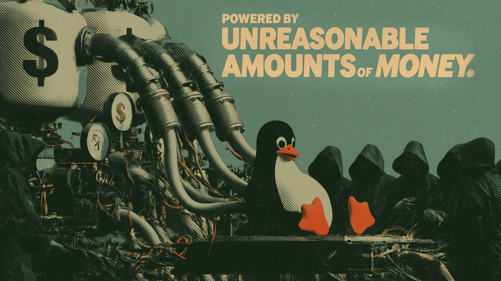
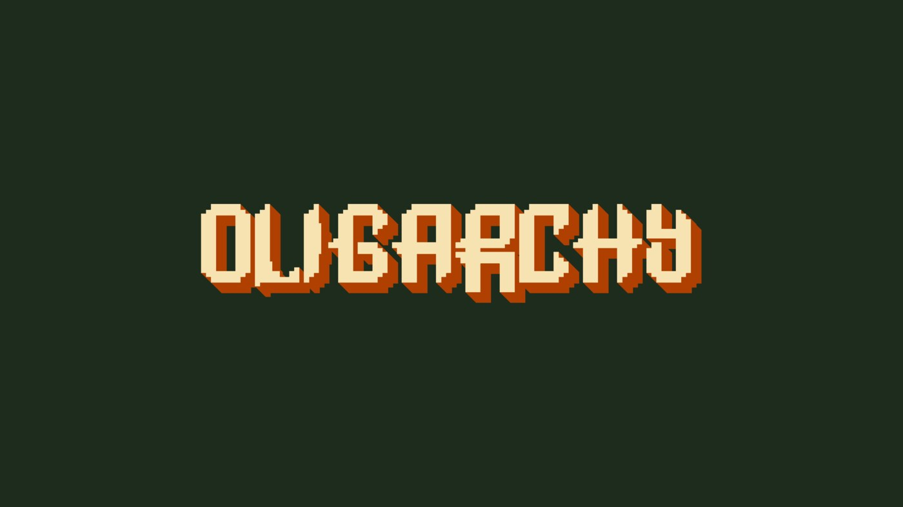

# Oligarchy

An [Omarchy](https://omarchy.org/) theme. Dark poster-green windows, cream text and a
rust accent, all taken from the retro-poster wallpapers about who actually pays for
your free operating system.


## Install

```bash
omarchy theme install https://github.com/erikrjohansson/oligarchy-theme.git
```

That clones the repo into `~/.config/omarchy/themes/oligarchy` and applies it.

To switch to it later, or after installing something else:

```bash
omarchy theme set oligarchy
```

Cycle through the wallpapers with `omarchy theme bg next`, or open the
picker with `omarchy theme bg-switcher`.

## Update

```bash
omarchy theme update
```

Updates every git-installed theme, this one included.

## Remove

```bash
omarchy theme remove oligarchy
```

## Backgrounds

Both wallpapers are 3840×2160. Click one for the full-size image.

[](backgrounds/1-unreasonable-amounts-of-money.jpg)

`1-unreasonable-amounts-of-money.jpg`

[](backgrounds/oligarchy.png)

`oligarchy.png` — the plain wordmark, in the style of the stock Omarchy
background. Sorts last, so `omarchy theme bg next` reaches it after the poster.

To add your own without touching this repo, drop images into
`~/.config/omarchy/backgrounds/oligarchy/` — Omarchy picks them up alongside the
bundled ones and they survive `omarchy theme update`.

## Palette

| | |
|---|---|
| background | `#1e2c1e` |
| dark background | `#172217` |
| darker background | `#111a11` |
| lighter background | `#2a3b2a` |
| foreground | `#f7e2b1` |
| accent | `#e7885d` |
| selection | `#5a4831` |
| muted | `#899786` |

| | normal | bright |
|---|---|---|
| red | `#d67d5e` | `#de9673` |
| yellow | `#e6ca91` | `#ead099` |
| green | `#9cc49c` | `#b3cca1` |
| cyan | `#90bfbb` | `#aac8b9` |
| blue | `#88aec1` | `#a4bbbd` |
| magenta | `#c2989a` | `#e7885d` |
| orange | `#e09865` | |
| brown | `#7b5438` | |

Icons: `Yaru` (orange folders, to match the rust).

## License

Theme files are MIT (see `LICENSE`). The wallpapers are AI-generated images,
free to use and redistribute with the theme.
